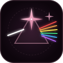
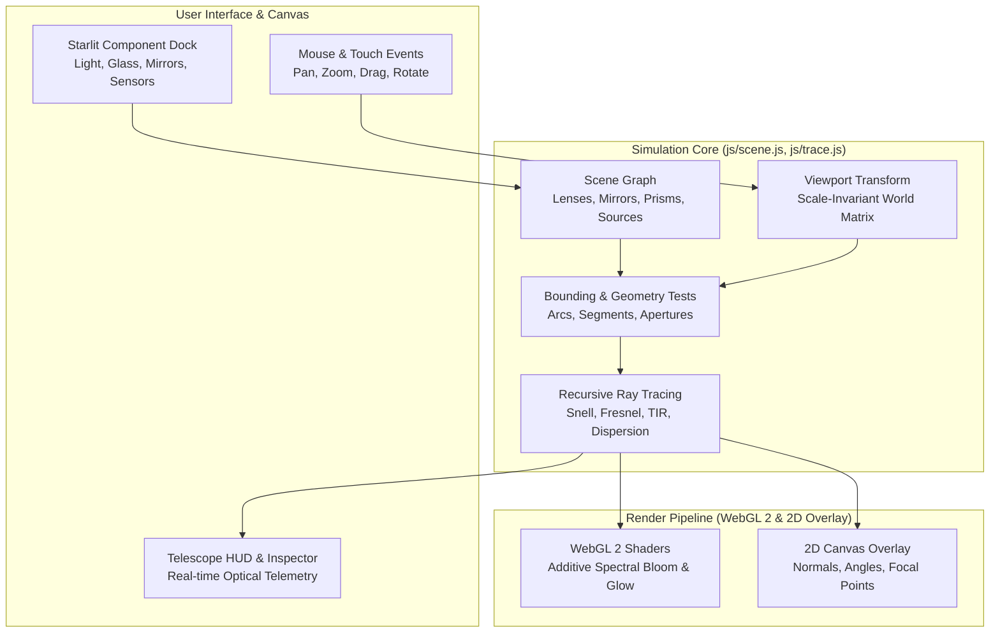

<div align="center">
  
  <h1>Optical Bench · Işık Masası</h1>
  <p><strong>Interactive 2D WebGL 2 Optical Bench, Astronomical Telescope Simulator & Physics Engine.</strong></p>

  <p>
    <strong>Language:</strong> <a href="README.md"><strong>EN</strong></a> | <a href="README.tr.md"><strong>TR</strong></a>
    &nbsp;•&nbsp;
    <a href="#overview">Overview</a> ·
    <a href="#telescope-suite">Telescope Suite</a> ·
    <a href="#physics-engine">Physics Engine</a> ·
    <a href="#how-it-works">How It Works</a> ·
    <a href="#controls">Controls</a> ·
    <a href="#support">Support</a>
  </p>

  <p>
    
    
    
    
    
    
    
  </p>
</div>

---

## Support

If **Optical Bench** is useful to you for education, research, or exploration, you can support its ongoing development:

<div align="center">
  <a href="https://buymeacoffee.com/hfatih" target="_blank">
    
  </a>
  &nbsp;&nbsp;
  <a href="https://github.com/sponsors/Hfatih" target="_blank">
    
  </a>
  <p><sub><em>Your support keeps the project independent, free, and continuously evolving.</em></sub></p>
</div>

---

## Overview

**Optical Bench (Işık Masası)** is a real-time, browser-native 2D optical physics simulation and telescope laboratory built with **pure WebGL 2 and Vanilla JavaScript (zero external dependencies)**.

It pairs high-speed GPU accelerated ray tracing with physically rigorous 2D optics:
- **Snell-Descartes Refraction & Cauchy Dispersion:** Prisms split white light into continuous rainbow spectra with wavelength-dependent refractive indices ($380\text{ nm} - 750\text{ nm}$).
- **Total Internal Reflection & Fresnel Splitting:** Glass blocks, D-blocks, and multifaceted brilliant-cut diamonds exhibit realistic critical-angle reflection and internal ray bouncing.
- **Full Astronomical Telescope Suite:** Real-time simulation of 8 telescope designs (Kepler, Galileo, Newton, Cassegrain with primary central baffle holes, Maksutov-Cassegrain, Schmidt-Cassegrain, Gregorian, and Beam Expanders) with live HUD telemetry.
- **Thin-Film Interference:** Soap bubbles calculate optical path phase differences to render iridescent rainbow surface colors.
- **Scale-Invariant Camera:** Smooth pan and zoom ($15\% - 350\%$). Physical optical metrics and refraction angles remain strictly invariant down to $10^{-7}\text{ rad}$ regardless of zoom depth.
- **Starlit Cosmic Dark UI:** Crafted in the signature Starlit aesthetic (#150a14 cosmic obsidian plum, #f0abc5 celestial rose, translucent glass cards, and 4-point sparkle stars ✦).

---

## Telescope Suite & Astronomical Systems

The simulator includes a dedicated astronomical optics engine with a real-time HUD telemetry card displaying angular magnification ($M$), tube length ($L$), objective/eyepiece focal lengths ($f_{obj}, f_{eye}$), chromatic aberration indicators, and inverted/upright image flags.

| Telescope Type | Optical Architecture | Key Formulation | Optical Characteristics |
| :--- | :--- | :--- | :--- |
| **Kepler Refractor** | Convex Objective + Convex Eyepiece | $M = \frac{f_{obj}}{f_{eye}}, \quad L = f_{obj} + f_{eye}$ | Inverted real intermediate image; wide field of view; chromatic dispersion present. |
| **Galileo Refractor** | Convex Objective + Concave Eyepiece | $M = \frac{f_{obj}}{\|f_{eye}\|}, \quad L = f_{obj} - \|f_{eye}\|$ | Upright direct image; ultra-compact tube; narrower apparent field of view. |
| **Newtonian Reflector** | Parabolic Concave Primary + $45^\circ$ Secondary Flat | $f = \frac{R}{2}, \quad M = \frac{f_{pri}}{f_{eye}}$ | 100% achromatic (zero chromatic aberration); $90^\circ$ side-exit eyepiece. |
| **Classical Cassegrain** | Perforated Concave Primary (Aperture Hole) + Convex Secondary | $f_{eff} = f_1 \cdot m, \quad M = \frac{f_{eff}}{f_{eye}}$ | Light passes back through primary mirror's central baffle hole; folded compact optical train. |
| **Maksutov-Cassegrain (Mak)** | Deep Spherical Meniscus Corrector + Silvered Spot Secondary | Corrects spherical aberration via all-spherical surfaces | Highly sealed tube; rugged thermal stability; razor-sharp planetary contrast. |
| **Schmidt-Cassegrain (SCT)** | Thin Aspheric Schmidt Plate + $f/2$ Primary + Secondary | Large focal length in an ultra-short chassis | Folded $3\times$ optical path; portable large-aperture standard. |
| **Gregorian Reflector** | Concave Primary + Concave Secondary past Primary Focus | $L = f_1 + f_2 + \Delta$ | Naturally upright image without erecting prisms; historical astronomical design. |
| **Beam Expander** | Reversed Keplerian / Galilean Collimator | Magnification $M = \frac{f_2}{f_1}$ | Expands laser beam diameter and decreases beam divergence. |

---

## Physics Engine

```
                             [ Incident Ray ]
                                    │
                                    ▼
                ────────────────── Boundary ───────────────────
                        │                             │
       [ Reflected Ray (Fresnel) ]           [ Refracted Ray (Snell) ]
             R = Fresnel(θ, n₁, n₂)               n₁ sin θ₁ = n₂ sin θ₂
                                                      │
                                                      ▼
                                            [ Cauchy Dispersion ]
                                            n(λ) = n₀ + B / λ²
```

### 1. Snell's Law & Refraction
For every boundary interface between media of refractive indices $n_1$ and $n_2$:
$$n_1 \sin \theta_1 = n_2 \sin \theta_2$$
When transitioning from a denser medium ($n_1 > n_2$) at an incident angle exceeding the critical angle:
$$\theta_c = \arcsin\left(\frac{n_2}{n_1}\right)$$
the beam undergoes **100% Total Internal Reflection (TIR)** with zero loss.

### 2. Cauchy Dispersion Equation
Refractive materials (Crown glass, Flint glass, Diamond, Water) apply Cauchy's dispersion formula:
$$n(\lambda) = n_d + B \left(\frac{1}{\lambda^2} - \frac{1}{\lambda_d^2}\right)$$
This separates polychromatic beams into individual spectral wavelengths ($380\text{ nm}$ to $750\text{ nm}$), accurately reproducing prism rainbows and lens chromatic aberration.

### 3. Fresnel Reflections
Unpolarized light splits at optical boundaries based on the Fresnel equations:
$$R_s = \left| \frac{n_1 \cos \theta_1 - n_2 \cos \theta_2}{n_1 \cos \theta_1 + n_2 \cos \theta_2} \right|^2, \quad R_p = \left| \frac{n_2 \cos \theta_1 - n_1 \cos \theta_2}{n_2 \cos \theta_1 + n_1 \cos \theta_2} \right|^2$$
$$R_{eff} = \frac{R_s + R_p}{2}$$

### 4. Thin-Film Wave Interference
For soap bubbles and optical coatings of thickness $d$ and refractive index $n_f$:
$$\Delta = 2 n_f d \cos \theta_t + \frac{\lambda}{2} = m \lambda$$
Constructive and destructive wave interference calculates wavelength-dependent iridescence across the bubble surface.

### 5. Zoom & Scale Invariance
Unlike naive canvas implementations that scale ray calculations with screen pixels, this physics engine separates **world coordinates** from **camera viewport transforms**. Intrinsic optical properties ($f$, beam width, ray spacing, surface curvature $R$) remain constant across $15\% - 350\%$ zoom, preserving ray trajectories with machine precision ($< 10^{-7}\text{ rad}$).

---

## How It Works



---

## Interactive Controls & Shortcuts

| Action | Control | Description |
| :--- | :--- | :--- |
| **Pan Canvas** | `Left Click + Drag` on empty space | Move the entire optical bench seamlessly |
| **Zoom View** | `Mouse Wheel` on empty space | Smooth zoom from $15\%$ up to $350\%$ |
| **Center Scene** | `Double Click` or `✦ Center` button | Center and frame all components into view |
| **Move Component** | `Left Click + Drag` component | Reposition any optical element on the table |
| **Rotate Component** | `Shift + Mouse Wheel` or Drag Rotate Handle | Rotate selected element with degree snapping |
| **Duplicate Component** | `Ctrl + D` or `Alt + Drag` | Clone component with all optical parameters preserved |
| **Delete Component** | `Delete` or `Backspace` | Remove selected component from the bench |
| **Toggle HUD / Telemetry** | Click telescope preset button | Displays live focal analysis and optical formulas |
| **Toggle Normals** | Top-Right `Normal Line` button | Shows surface normal vectors and angles ($\theta_1, \theta_2$) |
| **Toggle Focal Points** | Top-Right `Focal (F)` button | Highlights theoretical focal points ($F, 2F$) |
| **Snapshot** | Top-Right `Camera` button | Captures high-resolution PNG image of the setup |

---

## Available Optical Components

### 💡 Light Sources
- **Single Laser:** Monochromatic coherent beam with tunable wavelength ($380\text{ nm} - 750\text{ nm}$) and power.
- **Multibeam (Ray Box):** 5 parallel equidistant rays for demonstrating lens refraction and mirror focal points.
- **White Beam:** Broad collimated white light beam for prism dispersion experiments.
- **Point Source:** Omnidirectional or fan-shaped divergent point emitter.

### 🔮 Refractive Optics
- **Equilateral Prism:** $60^\circ$ dispersive prism for rainbow splitting.
- **Right-Angle (Porro) Prism:** $45^\circ-90^\circ-45^\circ$ prism for $90^\circ$ and $180^\circ$ Total Internal Reflection.
- **Biconvex / Biconcave Lens:** Adjustable focal length, aperture radius, and glass substrate (Crown / Flint).
- **Plano-Convex Lens:** Asymmetric spherical lens element.
- **Glass Block:** Rectangular optical slab demonstrating parallel lateral beam displacement.
- **D-Block (Semi-Circular):** Classic bench tool for verifying Snell's Law and measuring critical angle $\theta_c$.
- **Diamond:** Multi-faceted brilliant cut diamond showcasing high refractive index ($n=2.42$) and sparkling internal bounces.
- **Soap Bubble:** Thin-film spherical membrane exhibiting interference fringes.

### 🪞 Reflective Optics
- **Flat Mirror:** $100\%$ specular reflection line segment.
- **Concave Mirror:** Spherical/parabolic focusing mirror ($f = R / 2$).
- **Convex Mirror:** Diverging reflective mirror.
- **Beam Splitter:** $50/50$ semitransparent dielectric coating.

### 📏 Laboratory Tools
- **Observation Screen:** Opaque detector plate showing incident beam spots and spectral distributions.
- **Slit Aperture:** Variable width barrier for controlling beam width.
- **Optical Sensor:** Real-time photometer measuring incident spectral power.
- **360° Protractor:** Overlay angular measurement tool.
- **Metric Ruler:** Calibrated scale for measuring focal distances.

---

## Quick Start & Running Locally

The project requires **no build step, no npm install, and no external dependencies**. Run it with any standard HTTP server or open directly in a modern WebGL 2 capable browser.

### Option 1: Python HTTP Server (Built-in)
```bash
# Clone the repository
git clone https://github.com/Hfatih/optical-bench.git
cd optical-bench

# Start local server (Python 3)
python -m http.server 8080
```
Open `http://localhost:8080` in your browser.

### Option 2: Node.js (npx serve)
```bash
npx serve .
```

### Option 3: VS Code Live Server
Right-click `index.html` and select **"Open with Live Server"**.

---

## Verification & Test Suite

The project includes an automated, zero-dependency Node.js verification test bench ([test-bench.js](test-bench.js)) verifying all 11 core optical physics and navigation invariants:

```bash
node test-bench.js
```

### Test Coverage:
1. **Material Indices & Wavelengths:** Cauchy coefficients for Crown ($n_d = 1.517$) and Flint ($n_d = 1.620$) glass; spectrum labeling ($532\text{ nm}$ Green, $633\text{ nm}$ Red).
2. **Preset Verification:** All 18 optical presets (including all 8 telescopes) spawn valid geometry and generate active ray segments.
3. **Single-Spawn Click Guard:** Prevents duplicate component generation on a single click.
4. **Camera Navigation:** World coordinate transformation and scene centering invariants.
5. **Zoom Boundaries:** Deep zoom validation down to $15\% - 20\%$ zoom levels.
6. **Component Duplication:** Deep cloning with exact geometric parameter preservation (`mlen`, `refl`, etc.).
7. **Pick Tolerance:** Graceful selection tolerance for thin mirrors and delicate optical surfaces.
8. **Item Lifecycle:** Clean deletion and dynamic state subscriber firing.
9. **Preset Cleanliness:** Verifies absence of redundant observation screens in telescope and refraction experiments.
10. **Refraction & Zoom Scale Invariance:** Snell's law refraction angles remain invariant across zooms ($15\%$ to $350\%$) with error $< 10^{-7}\text{ rad}$.
11. **Cassegrain Central Hole Ray Tracing:** Perforated primary mirror geometry verification and optical throughput through the central baffle hole.

---

## Project Structure

```
optical-bench/
├── index.html          # Main application structure, HUD telemetry & dock
├── style.css           # Starlit design system, glass cards & CSS layout
├── test-bench.js       # Zero-dependency automated test suite (11/11 tests)
├── docs/
│   └── images/
│       └── logo.svg    # Starlit vector brand logo
├── js/
│   ├── spectrum.js     # Wavelength to RGB conversion & Cauchy dispersion
│   ├── scene.js        # Scene state graph, optical geometries & telescope setups
│   ├── trace.js        # 2D optical ray tracing engine (Snell, TIR, Fresnel)
│   ├── glass.js        # Refractive polygons & arc boundary intersections
│   ├── gl.js           # WebGL 2 shader pipeline & additive glow effects
│   ├── ui.js           # Canvas interactions, HUD telemetry, dock & camera
│   └── main.js         # Application bootstrap & animation loop
└── LICENSE             # MIT License
```

---

## License

Released under the [MIT License](LICENSE).

Developed with ✦ by [Fatih Han](https://github.com/Hfatih).
