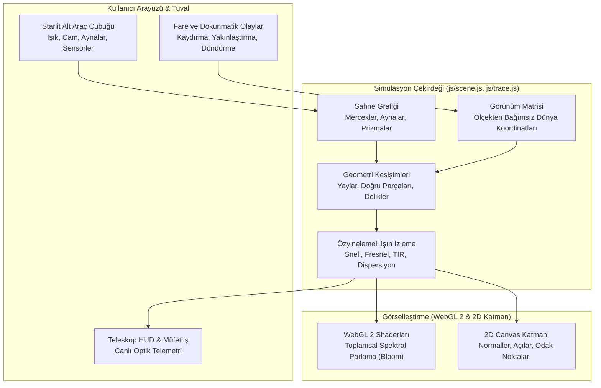

<div align="center">
  
  <h1>Işık Masası · Optik Laboratuvarı</h1>
  <p><strong>WebGL 2 Destekli Etkileşimli 2D Optik Masası, Astronomik Teleskop Simülatörü ve Fizik Motoru.</strong></p>

  <p>
    <strong>Dil:</strong> <a href="README.md"><strong>EN</strong></a> | <a href="README.tr.md"><strong>TR</strong></a>
    &nbsp;•&nbsp;
    <a href="https://hfatih.github.io/optical-bench/"><strong>✦ Canlı Simülasyon (GitHub Pages)</strong></a> ·
    <a href="https://optical.hfatih.com"><strong>optical.hfatih.com</strong></a> ·
    <a href="#genel-bakış">Genel Bakış</a> ·
    <a href="#teleskop-laboratuvarı">Teleskoplar</a> ·
    <a href="#optik-fizik-motoru">Fizik Motoru</a> ·
    <a href="#nasıl-çalışır">Nasıl Çalışır</a> ·
    <a href="#kontroller">Kontroller</a> ·
    <a href="#destek">Destek</a>
  </p>

  <p>
    <a href="https://hfatih.github.io/optical-bench/"></a>
    <a href="https://optical.hfatih.com"></a>
    
    
    
    
    
    
    
  </p>
</div>

---

## Destek

Eğer **Işık Masası** eğitim, araştırma veya hobileriniz için faydalı olduysa projeyi destekleyebilirsiniz:

<div align="center">
  <a href="https://buymeacoffee.com/hfatih" target="_blank">
    
  </a>
  &nbsp;&nbsp;
  <a href="https://github.com/sponsors/Hfatih" target="_blank">
    
  </a>
  <p><sub><em>Desteğiniz projenin bağımsız, ücretsiz ve sürekli güncel kalmasını sağlar.</em></sub></p>
</div>

---

## Genel Bakış

**Işık Masası**, tarayıcı üzerinde herhangi bir harici kütüphane veya paket gerektirmeksizin (**sıfır bağımlılık, saf WebGL 2 ve Vanilla JS**) çalışan gerçek zamanlı bir 2D optik fizik simülatörü ve teleskop laboratuvarıdır.

- **Snell-Descartes Kırılması ve Cauchy Dispersiyonu:** Prizmalar, beyaz ışığı dalga boyuna bağlı kırıcılık indisiyle ($380\text{ nm} - 750\text{ nm}$) gerçek gökkuşağı tayfına ayrıştırır.
- **Tam İç Yansıma ve Fresnel Yansıması:** Cam bloklar, D-bloklar ve elmaslar kritik açı sınırlarını ve iç ışık yansımalarını simüle eder.
- **Detaylı Teleskop Laboratuvarı:** Kepler, Galileo, Newton, ortası delikli Cassegrain, Maksutov-Cassegrain (Mak), Schmidt-Cassegrain (SCT), Gregoryen ve Işın Genişleticiler canlı optik telemetri paneliyle (HUD) incelenebilir.
- **İnce Zar Girişimi:** Sabun köpüklerinde optik yol faz farkı hesaplanarak yanardöner yüzey renkleri oluşturulur.
- **Ölçekten Bağımsız Kamera (Scale-Invariant Zoom):** %15'ten %350'ye kadar uzaklaşma/yakınlaşma yapılabilir; kamera yakınlaştırması Snell kırılma açılarını $10^{-7}\text{ rad}$ hassasiyetle korur.
- **Starlit Kozmik Koyu Tema:** Gece gökyüzü estetiği (#150a14 obsidyen mürdüm, #f0abc5 göksel gül rengi, yarı saydam cam paneller ve 4 köşeli ışıltılı yıldızlar ✦).

---

## Teleskop Laboratuvarı

Simülatör, teleskop seçildiğinde açısal büyütme ($M$), tüp uzunluğu ($L$), odak uzaklıkları ($f_{obj}, f_{eye}$), renk sapıncı durumu ve görüntü yönünü anlık hesaplayan bir telemetri kartı (HUD) sunar:

| Teleskop Türü | Optik Mimarisi | Temel Formül | Optik Özellikleri |
| :--- | :--- | :--- | :--- |
| **Kepler Refraktörü** | Dışbükey Objektif + Dışbükey Oküler | $M = \frac{f_{obj}}{f_{eye}}, \quad L = f_{obj} + f_{eye}$ | Ters ara görüntü; geniş görüş alanı; renk sapıncı (kromatizm) mevcuttur. |
| **Galileo Refraktörü** | Dışbükey Objektif + İçbükey Oküler | $M = \frac{f_{obj}}{\|f_{eye}\|}, \quad L = f_{obj} - \|f_{eye}\|$ | Düz görüntü; kısa ve kompakt gövde; dar görüş alanı. |
| **Newton Reflektörü** | Parabolik Çukur Birincil + $45^\circ$ Düz İkincil Ayna | $f = \frac{R}{2}, \quad M = \frac{f_{pri}}{f_{eye}}$ | %100 akromatik (renk sapıncı sıfır); $90^\circ$ yan çıkışlı oküler. |
| **Klasik Cassegrain** | Delikli Çukur Birincil + Dışbükey Hiperbolik İkincil | $f_{eff} = f_1 \cdot m, \quad M = \frac{f_{eff}}{f_{eye}}$ | Işık birincil aynanın ortasındaki delikten arkaya geçer; katlanmış optik yol. |
| **Maksutov-Cassegrain (Mak)** | Menisküs Düzeltici Cam + Gümüş Benek İkincil Ayna | Küresel sapınç düzeltilmiş tam küresel yüzeyler | Kapalı optik tüp; üstün mekanik dayanıklılık; kusursuz gezegen kontrastı. |
| **Schmidt-Cassegrain (SCT)** | Asferik Schmidt Plakası + $f/2$ Hızlı Ayna + Katlama | Kompakt tüp içinde çok uzun odak uzaklığı | Optik yolu 3 kat katlar; amatör astronominin standart taşınabilir teleskobu. |
| **Gregoryen Teleskobu** | Çukur Birincil + Odak Ötesinde Çukur İkincil Ayna | $L = f_1 + f_2 + \Delta$ | Prizma gerektirmeden doğal düz görüntü verir; tarihi astronomik tasarım. |
| **Işın Genişletici** | Ters Kepler / Galileo Kolimatörü | Büyütme $M = \frac{f_2}{f_1}$ | Lazer demet çapını genişletir ve ışın ıraksamasını azaltır. |

---

## Optik Fizik Motoru

### 1. Snell-Descartes Kanunu
Farklı kırıcılık indislerine ($n_1, n_2$) sahip ortam sınırlarında:
$$n_1 \sin \theta_1 = n_2 \sin \theta_2$$
Çok yoğun ortamdan az yoğun ortama geçerken incident açısı kritik açıyı aştığında:
$$\theta_c = \arcsin\left(\frac{n_2}{n_1}\right)$$
ışın **%100 Tam İç Yansıma (TIR)** yaparak geri döner.

### 2. Cauchy Dispersiyon Formülü
Cam malzemelerde dalga boyuna bağlı kırıcılık indisi:
$$n(\lambda) = n_d + B \left(\frac{1}{\lambda^2} - \frac{1}{\lambda_d^2}\right)$$
Bu formül sayesinde prizmadan geçen beyaz ışık mordan kırmızıya ($380\text{ nm} - 750\text{ nm}$) tayfa ayrışır.

### 3. Fresnel Yansıma Katsayıları
Kutuplanmamış ışık için arayüz yansıma ve kırılma oranları:
$$R_s = \left| \frac{n_1 \cos \theta_1 - n_2 \cos \theta_2}{n_1 \cos \theta_1 + n_2 \cos \theta_2} \right|^2, \quad R_p = \left| \frac{n_2 \cos \theta_1 - n_1 \cos \theta_2}{n_2 \cos \theta_1 + n_1 \cos \theta_2} \right|^2$$
$$R_{eff} = \frac{R_s + R_p}{2}$$

### 4. İnce Film Girişimi (Sabun Köpüğü)
$$2 n_f d \cos \theta_t + \frac{\lambda}{2} = m \lambda$$
İnce sabun zarlarında dalga tepeleri ve çukurları yapıcı ve bozucu girişim yaparak yanardöner renk desenleri oluşturur.

---

## Nasıl Çalışır



---

## Kontroller ve Kısayollar

| Eylem | Kontrol | Açıklama |
| :--- | :--- | :--- |
| **Masayı Kaydır (Pan)** | Boş alanda `Sol Tık + Sürükle` | Tüm optik masayı serbestçe gezdirir |
| **Yakınlaştır / Uzaklaştır** | Boş alanda `Fare Tekerleği` | %15 ile %350 arasında kusursuz zoom |
| **Ortala** | `Çift Tıklama` veya `✦ Ortala` | Tüm elemanları kadraja sığdırır |
| **Elemanı Taşı** | Eleman üzerine `Sol Tık + Sürükle` | Optik parçanın konumunu değiştirir |
| **Elemanı Döndür** | Eleman seçiliyken `Shift + Tekerlek` | Açıyı derece hassasiyetiyle çevirir |
| **Elemanı Çoğalt** | `Ctrl + D` veya `Alt + Sürükle` | Tüm parametreleriyle kopyasını üretir |
| **Elemanı Sil** | `Delete` veya `Backspace` | Seçili optik parçayı kaldırır |
| **Normal Çizgileri** | Sağ üst `Normal Çizgisi` butonu | Arayüz teğet ve normallerini ($\theta_1, \theta_2$) gösterir |
| **Odak Noktaları** | Sağ üst `Odak (F)` butonu | Kuramsal odak noktalarını ($F, 2F$) işaretler |
| **Fotoğraf Al** | Sağ üst `Kamera` butonu | Yüksek çözünürlüklü şeffaf PNG kaydeder |

---

## Yerel Olarak Çalıştırma

Projede derleme, paket yükleme (`npm install`) veya harici bağımlılık yoktur. Doğrudan bir web sunucusu ile başlatabilirsiniz:

### Python 3 ile:
```bash
git clone https://github.com/Hfatih/optical-bench.git
cd optical-bench
python -m http.server 8080
```
Tarayıcınızda `http://localhost:8080` adresini açın.

### Node.js (npx) ile:
```bash
npx serve .
```

---

## Doğrulama ve Test Paketi

Proje, 11 temel fizik ve arayüz kuralını doğrulayan bağımsız bir test betiği ([test-bench.js](test-bench.js)) içerir:

```bash
node test-bench.js
```

Tüm testler hatasız şekilde tamamlanır (`exit code: 0`).

---

## Lisans

[MIT Lisansı](LICENSE) kapsamında açık kaynak olarak yayınlanmıştır.

✦ [Fatih Han](https://github.com/Hfatih) tarafından geliştirilmiştir.
